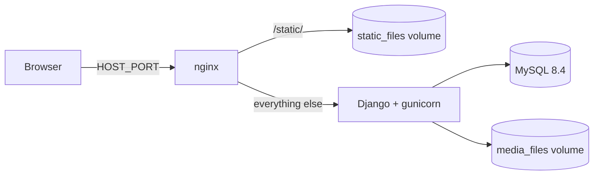
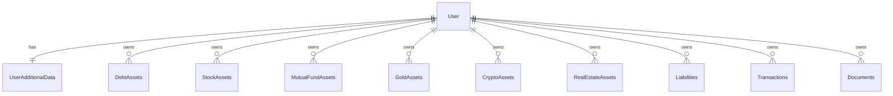

# Finance Manager

A multi-user personal finance web app built with Django. Each user tracks their assets, liabilities, transactions and important documents, and sees a net-worth overview. Data is private per user and can be exported to and imported from JSON.

## Features

- **Accounts:** sign up and login on one page, logout, profile page, and password reset by email.
- **Portfolio overview:** total assets, total liabilities, net worth, per-category totals and counts, and the 10 most recent entries.
- **Asset categories** (each with list, create, view, edit and delete):

  | Category | Type options | Extra fields |
  |---|---|---|
  | Debt assets | Bank account, FD/RD, Govt securities, Debt mutual fund | |
  | Stocks | Large cap, Mid cap, Small cap | |
  | Mutual funds | | Large, mid, small cap and debt percentages (must sum to 100) |
  | Gold | Physical, Digital, SGB, Gold mutual fund | |
  | Crypto | | |
  | Real estate | | |

- **Liabilities** and **Transactions** (name, from party, to party, amount; the two parties must differ).
- **Documents:** upload PDF, PNG, JPG or JPEG files up to 5 MB. Files are checked by extension and by content signature, stored under a random name, and served only to their owner through a login-protected view.
- **Data export and import:** download all assets, liabilities and transactions as JSON, and re-import them from the profile page. Import validates every record first and saves in a single transaction, with an option to replace existing data. Documents are not included.
- **Localisation:** all UI text uses translation keys, resolved through `locale/en/LC_MESSAGES/django.po`.

## Tech stack

| Layer | Technology |
|---|---|
| Backend | Python 3.12, Django 5.2 |
| Database | MySQL 8 through PyMySQL |
| Frontend | Django templates, Bootstrap, jQuery, vanilla JS (AJAX for CRUD) |
| Config | `django-environ` |
| Serving (Docker) | gunicorn behind nginx |

## Project structure

```
FinaceManager/          Project package: settings.py, urls.py, wsgi.py, asgi.py, .env.example
Users/                  Auth pages, profile, data export/import endpoints, UserAdditionalData model
AssetsLiabilities/      Assets, liabilities, transactions, documents
  models.py             One model per category, all linked to the Django User
  forms.py              Validation for every model, plus the import form
  views.py              CRUD views generated by AssetViewFactory, plus document views
  data_transfer.py      JSON export and import logic
  constants.py          Type choices, upload limits, file signatures, export format
  static/ templates/    Page-specific CSS, JS and HTML
templates/base.html     Shared layout, toast container, delete-confirmation modal
static/                 Bootstrap, jQuery, shared styles
locale/en/              Translation catalogue
docker/                 nginx config template
Dockerfile, docker-compose.yml, install.ps1, install.sh
```

### How the code is organised

- Each category has JSON endpoints created by `AssetViewFactory` in `AssetsLiabilities/views.py`. The page itself is a template, and the JavaScript in `static/js/asset_manager.js` calls the endpoints with `fetch`/AJAX: `GET` list (with `X-Requested-With: XMLHttpRequest`), `POST` create, `GET` detail, `PUT` update and `DELETE` delete.
- Every query is filtered by `request.user`, so one user can never read or change another user's records.
- Documents use multipart uploads, so they have their own views instead of the factory.

### URL map

| Path | Purpose |
|---|---|
| `/`, `/login/`, `/signup/` | Login and signup page |
| `/portfolio/` | Portfolio overview (`/dashboard/` redirects here) |
| `/debt-assets/`, `/stock-assets/`, `/mutual-funds/`, `/gold-assets/`, `/crypto-assets/`, `/real-estate/`, `/liabilities/`, `/transactions/` | List page; add `create/`, `<id>/`, `<id>/update/`, `<id>/delete/` for the API |
| `/documents/` | List page; also `create/`, `<id>/`, `<id>/update/`, `<id>/delete/` and `<id>/file/` (`?download=1` to download) |
| `/profile/`, `/profile/export/`, `/profile/import/` | Profile, JSON export and import |
| `/forgot-password/`, `/reset-password/<uid>/<token>/` | Password reset flow |
| `/admin/` | Django admin |

## Configuration

All settings come from environment variables. Locally they are read from `FinaceManager/.env`; in Docker, Compose passes the same file into the containers. Copy `FinaceManager/.env.example` to `FinaceManager/.env` and edit it. The real `.env` is git-ignored.

| Variable | Purpose |
|---|---|
| `SECRET_KEY`, `DEBUG`, `ALLOWED_HOSTS` | Django core settings |
| `DATABASE_NAME`, `DATABASE_USER`, `DATABASE_PASSWORD`, `DATABASE_HOST`, `DATABASE_PORT` | MySQL connection |
| `DATABASE_ROOT_PASSWORD`, `DB_TIMEZONE` | Docker only: MySQL root password and container timezone |
| `HOST_PORT`, `APP_PORT`, `WEB_CONCURRENCY` | Docker only: published port, gunicorn port and worker count |
| `EMAIL_HOST`, `EMAIL_PORT`, `EMAIL_USE_TLS`, `EMAIL_HOST_USER`, `EMAIL_HOST_PASSWORD`, `DEFAULT_FROM_EMAIL` | Password-reset email. Leave `EMAIL_HOST` empty to print emails to the console/logs |

## Running with Docker (recommended)

Prerequisite: Docker Desktop installed and running (on Windows, with WSL 2).

On macOS, open Docker Desktop and run:

```sh
./install.sh
```

On Windows, run:

```powershell
.\install.ps1
```

Either script creates `FinaceManager/.env` with random secrets if it is missing, builds the images, starts the stack and waits until the app responds. Then open <http://localhost:8000> (or your `HOST_PORT`). It is safe to re-run, for example after `git pull`.

You can also run Compose directly from macOS or Windows PowerShell:

```sh
docker compose --env-file FinaceManager/.env up -d --build
```

If you start Compose directly and the env file does not exist yet, copy `FinaceManager/.env.example` to `FinaceManager/.env` first and replace its placeholder secrets.

### Architecture



- **`db`:** MySQL, data in the `db_data` volume, not published to the host, with a healthcheck.
- **`backend`:** starts only after the database is healthy. On every start it runs `migrate` and `collectstatic`, then gunicorn.
- **`web`:** nginx is the only published service. It serves `/static/` directly and proxies everything else to the backend. Uploaded files are never served by nginx.
- All services use `restart: unless-stopped`, so they come back when Docker Desktop starts.

### Everyday commands

Compose reads the env file from a non-default location, so pass it each time:

```sh
docker compose --env-file FinaceManager/.env logs -f backend      # logs
docker compose --env-file FinaceManager/.env stop                 # stop
docker compose --env-file FinaceManager/.env up -d                # start again
docker compose --env-file FinaceManager/.env up -d --build        # rebuild after code changes
docker compose --env-file FinaceManager/.env exec backend python manage.py createsuperuser
docker compose --env-file FinaceManager/.env down -v              # remove containers AND all data
```

## Running without Docker

Requires Python 3.12 and a MySQL 8 server.

macOS/Linux:

```sh
python -m venv .venv
source .venv/bin/activate
pip install -r requirements.txt
cp FinaceManager/.env.example FinaceManager/.env
```

Windows PowerShell:

```powershell
python -m venv .venv
.venv\Scripts\Activate.ps1
pip install -r requirements.txt
Copy-Item FinaceManager/.env.example FinaceManager/.env
```

Edit `FinaceManager/.env` for your local setup: set `DEBUG=True`, `DATABASE_HOST=localhost` and your own database credentials, and create the database first. Then:

```sh
python manage.py migrate
python manage.py createsuperuser
python manage.py runserver
```

## Data model



Amounts are stored as whole numbers (`IntegerField`). Records are deleted together with their user, and deleting a document also removes its stored file.

## Export file format

```json
{
  "app": "finance_manager",
  "version": 1,
  "exported_at": "2026-10-31T10:00:00+00:00",
  "username": "alice",
  "data": {
    "debt_assets": [{ "name": "Savings", "type": "bank_account", "amount": 50000 }],
    "stock_assets": [],
    "mutual_funds": [],
    "gold_assets": [],
    "crypto_assets": [],
    "real_estate": [],
    "liabilities": [],
    "transactions": []
  }
}
```

Import accepts `.json` files up to 2 MB, checks the `app` and `version` fields, and reuses the same form validation as the UI. Unknown sections are ignored.

## Security notes

- Passwords use Django's built-in hashing and validators; CSRF protection is on.
- All data access is scoped to the logged-in user.
- Uploaded documents are checked for extension, size and file signature, stored with random names, and never exposed through a public URL. They are sent with `X-Content-Type-Options: nosniff`.
- Secrets are read from `.env`, which is excluded from git and from the Docker image.
- The Docker setup runs gunicorn as a non-root user and does not publish the database port.

## Limitations

- The Docker setup serves plain HTTP on the local machine. For internet-facing use, put it behind an HTTPS proxy and review the cookie and security settings first.
